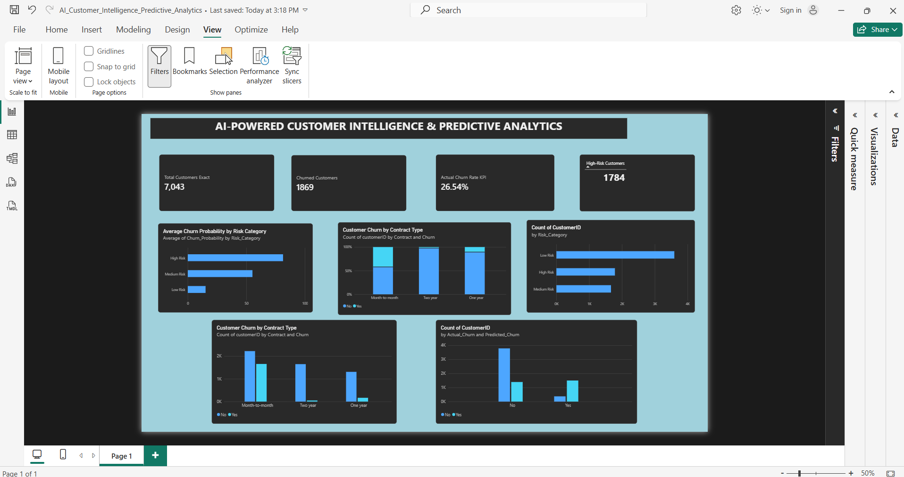

# AI-Powered Customer Intelligence & Predictive Analytics Platform

## 1. Project Overview

The AI-Powered Customer Intelligence & Predictive Analytics Platform is a data analytics and machine learning project designed to analyze customer data, identify churn patterns, and predict customers who may be at risk of leaving a service.

This project combines Python, SQL, Machine Learning, and Power BI to convert raw customer data into meaningful business insights.

## Power BI Dashboard Preview



## 2. Problem Statement

Customer churn is a major challenge for businesses because losing customers can affect revenue and business growth.

The main objective of this project is to:

- Analyze customer information and behavior.
- Identify important factors related to customer churn.
- Build a machine learning model to predict churn probability.
- Categorize customers into Low, Medium, and High Risk.
- Create an interactive Power BI dashboard to support business decisions.

## 3. Dataset

**Dataset Name:** IBM Telco Customer Churn

**Dataset Source:** Kaggle

[Download Dataset](https://www.kaggle.com/datasets/blastchar/telco-customer-churn)

- Total Records: 7,043
- Total Columns: 21
- Target Variable: Churn
- Data Format: CSV

The dataset contains customer details such as gender, tenure, contract type, internet service, monthly charges, total charges, and churn status.

## 4. Technologies Used

- **Python:** Data cleaning, analysis, and machine learning.
- **Pandas & NumPy:** Data manipulation and numerical operations.
- **Matplotlib:** Data visualization.
- **Scikit-learn:** Machine learning and model evaluation.
- **SQL:** Data storage and customer analysis.
- **MySQL:** Database management.
- **Power BI:** Interactive dashboards and reporting.
- **DAX:** Measures and calculations.
- **Power Query:** Data transformation.
- **VS Code:** Development environment.

## 5. Project Workflow

### Step 1: Data Collection and Cleaning

- Collected the IBM Telco Customer Churn dataset.
- Checked missing values and duplicate records.
- Converted TotalCharges into a numeric format.
- Handled 11 blank TotalCharges values.
- Saved the cleaned dataset for further analysis.

### Step 2: Exploratory Data Analysis (EDA)

- Analyzed customer churn distribution.
- Studied churn based on contract type.
- Compared average tenure of churned and non-churned customers.
- Analyzed monthly charges.
- Created visualizations using Matplotlib.

### Step 3: SQL Analysis

- Imported customer data into MySQL.
- Created and executed SQL queries.
- Analyzed customer churn by contract type.
- Calculated average monthly charges.
- Identified customers meeting selected high-risk screening conditions.
- Created customer segments based on tenure.

### Step 4: Machine Learning

- Prepared features and target variables.
- Split the dataset into 80% training and 20% testing data.
- Applied numerical scaling and categorical encoding.
- Trained Logistic Regression and Random Forest models.
- Compared model performance using evaluation metrics.
- Selected Logistic Regression as the initial model based on its higher churn recall and F1 score.
- Saved the trained model using Joblib.

### Step 5: Customer Churn Prediction

- Predicted churn probability for customers.
- Generated a customer risk report.
- Categorized customers using probability thresholds:

| Risk Category | Probability      |
| ------------- | ---------------- |
| High Risk     | 70% or above     |
| Medium Risk   | 40% to below 70% |
| Low Risk      | Below 40%        |

### Step 6: MySQL Integration

- Imported customer risk predictions into MySQL.
- Stored customer information and prediction results in separate tables.
- Connected MySQL with Power BI.

### Step 7: Power BI Dashboard

Created an interactive dashboard to display customer churn insights and model predictions.

Dashboard KPIs:

- Total Customers: 7,043
- Churned Customers: 1,869
- Actual Churn Rate: 26.54%
- High-Risk Customers: 1,784

Dashboard Visualizations:

- Customer Count by Risk Category
- Customer Churn by Contract Type
- Actual vs Predicted Churn
- Average Churn Probability by Risk Category
- Churn Percentage by Contract Type

## 6. Machine Learning Model Evaluation

Two machine learning algorithms were compared:

- Logistic Regression
- Random Forest

### Model Performance

| Evaluation Metric | Logistic Regression | Random Forest |
| ----------------- | ------------------: | ------------: |
| Accuracy          |              73.81% |        78.42% |
| Precision         |              50.43% |        62.32% |
| Recall            |              78.34% |        47.33% |
| F1 Score          |              61.36% |        53.80% |
| ROC-AUC           |              84.16% |        82.31% |

**Selected Model: Logistic Regression**

Logistic Regression was selected for the initial churn prediction workflow because it achieved higher recall and F1 score. It identified 293 out of 374 actual churners in the test dataset.

## 7. Customer Risk Analysis

The model generated risk predictions for 7,043 customers.

| Risk Category | Customer Count |
| ------------- | -------------: |
| High Risk     |          1,784 |
| Medium Risk   |          1,664 |
| Low Risk      |          3,595 |

These categories are based on model-estimated churn probabilities and the selected business thresholds.

## 8. Key Business Insights

- Month-to-month contract customers have a higher churn rate than customers with longer contracts.
- Customers who churned had a lower average tenure.
- Customers who churned had higher average monthly charges.
- Logistic Regression achieved better recall than Random Forest in the model comparison.
- Customer risk categories can help businesses identify customers who may need attention.

## 9. Project Structure

```text
AI_Customer_Intelligence/
│
├── .venv/
├── data/
├── dataset/
├── docs/
├── documentation/
├── machine learning/
├── models/
├── NLP_AI/
├── notebooks/
├── Power BI/
├── Python/
├── reports/
├── screenshot/
├── SQL/
├── SRC/
│
└── README.md
```

## 9.1 Project Deliverables

-Cleaned customer churn dataset.
-Exploratory data analysis charts.
-MySQL customer database.
-SQL analysis queries.
-Trained Logistic Regression model.
-Customer churn prediction report.
-Customer risk classification.
-Interactive Power BI dashboard.

## 10. Project Outcome

This project demonstrates how Python, SQL, Machine Learning, and Power BI can work together to analyze customer behavior and estimate churn risk.

It provides practical experience in data preprocessing, exploratory analysis, database management, predictive modeling, and business intelligence reporting.

## 11. Important Note

This project uses a publicly available IBM Telco Customer Churn dataset from Kaggle. The churn predictions are model estimates, not guaranteed future customer behavior.

The dataset does not contain customer review text. Any NLP or sentiment analysis work should use a separate text dataset and be documented separately.
